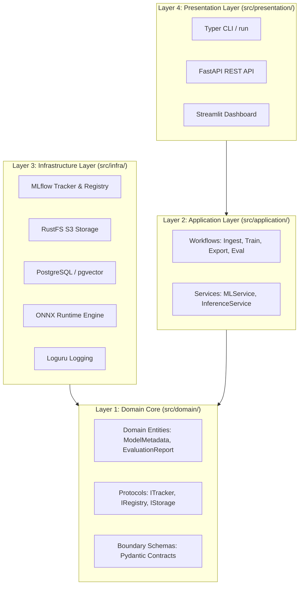

# 🏛️ System Architecture & Codebase Design

**Repository:** `sg_project_template`  
**Pattern:** Hexagonal / Onion / Clean Architecture (Dependency Inversion)  
**Typing Philosophy:** Structural Subtyping via `typing.Protocol` (PEP 544)  
**Packaging Mode:** Python Namespace Package (`src/` Application Mode, No `__init__.py`)  

---

## 🎯 Architecture Philosophy

This repository is built around **Clean Architecture** (also known as Onion or Hexagonal Architecture). The core tenet is the **Dependency Inversion Principle**: 

> *High-level business policies and domain logic must never depend on low-level technical mechanisms (databases, cloud SDKs, web frameworks). Both must depend on abstractions.*



---

## 🏗️ Project Directory Layout

```bash
.
├── run                                         # Root executable wrapper script for CLI commands
├── compose.yaml                                # Docker Compose configuration (MLflow, RustFS, Postgres, API, UI, Prometheus, Grafana)
├── pyproject.toml                              # Project metadata & dependencies (uv managed)
├── README.md                                   # Project instructions & quickstart guide
├── data/                                       # Data storage & runtime outputs
│   ├── raw/                                    # Immutable raw CSV/Parquet files
│   ├── processed/                              # Transformed & split training datasets
│   ├── models/                                 # Serialized trained models (.onnx, .pkl)
│   ├── reports/                                # Evidently drift reports (.html)
│   └── mlflow/                                 # Local MLflow SQLite tracking database & artifacts
├── docker/                                     # Container infrastructure & configurations
│   ├── app.Dockerfile                          # Production FastAPI & Streamlit container image
│   ├── marimo.Dockerfile                       # Interactive Marimo notebook container image
│   ├── prometheus/                             # Prometheus configuration & alerting rules
│   │   ├── prometheus.yml                      # Scrape intervals & targets config
│   │   └── alert_rules.yml                     # 6 MLOps & API threshold alerting rules
│   └── grafana/                                # Auto-provisioned dashboards & datasources
│       └── provisioning/
│           ├── datasources/datasource.yml      # Auto-configured Prometheus datasource
│           └── dashboards/
│               ├── dashboards.yml              # Dashboard provider configuration
│               └── fastapi_telemetry.json      # 20-panel visual MLOps & HTTP telemetry dashboard
├── docs/                                       # Architecture blueprints & operational documentation
│   ├── images/                                 # Architecture diagrams (onion-architecture.png)
│   ├── ARCHITECTURE.md                         # System architecture, layer rules & protocol specification
│   ├── TELEMETRY.md                            # Complete guide to FastAPI & MLOps live metrics
│   ├── MLOPS_ROADMAP.md                        # 2026 MLOps architectural specification
│   └── MLOPS_RATING.md                         # MLOps maturity assessment & scorecard (9.0/10)
├── notebooks/                                  # Root-level Marimo & Jupyter exploratory notebooks
│   ├── README.md                               # Marimo usage guide
│   ├── explore_marimo.py                       # Interactive Plotly analytics notebook
│   └── trial.ipynb                             # Jupyter notebook
├── src/                                        # Application source code (Clean Architecture)
│   ├── main.py                                 # Application CLI entrypoint (Typer commands)
│   ├── main_api.py                             # FastAPI application server launcher
│   ├── main_ui.py                              # Streamlit dashboard launcher
│   ├── version.py                              # Application version string (__version__)
│   ├── config.py                               # Centralized configuration & pydantic-settings SSOT
│   ├── application/                            # Application use cases, pipelines & services
│   │   ├── utils.py                            # Pipeline & application helper utilities
│   │   ├── pipelines/                          # Data, training, export & evaluation workflows
│   │   │   ├── ingest.py                       # Data loader, Pandera schema validation & split
│   │   │   ├── train.py                        # Model training loop, Optuna tuning & evaluation
│   │   │   ├── export.py                       # Model serialization & ONNX runtime conversion
│   │   │   └── evaluate.py                     # Metric calculation & statistical drift detection
│   │   └── services/                           # Application orchestration services
│   │       ├── ml_service.py                   # Orchestrates ingest -> train -> eval -> register
│   │       └── inference_service.py            # Low-latency inference engine backed by ONNX Runtime
│   ├── domain/                                 # Core domain models, schemas & contracts
│   │   ├── models/                             # Domain entities & business data classes
│   │   │   ├── llm_models.py                   # LLM configurations & prompt domain models
│   │   │   ├── ml_entities.py                  # Model & dataset registry domain dataclasses
│   │   │   └── sql_models.py                   # SQLModel relational table definitions
│   │   ├── repo_interfaces/                    # Protocol interfaces (structural duck typing)
│   │   │   ├── tracker_repository.py           # Protocol for MLflow/W&B experiment tracking
│   │   │   ├── registry_repository.py          # Protocol for model registry lifecycle operations
│   │   │   ├── storage_repository.py           # Protocol for S3/RustFS artifact & model storage
│   │   │   └── vectordb_repository.py          # Protocol for vector search & embeddings
│   │   └── schemas/                            # Boundary contracts & Pydantic validation schemas
│   │       ├── common.py                       # Generic API response envelopes & error schemas
│   │       └── ml_schemas.py                   # Prediction requests, responses & drift payloads
│   ├── infra/                                  # Infrastructure implementations & external adapters
│   │   ├── logging.py                          # Structured Loguru logger initialization
│   │   ├── supabase_client.py                  # Supabase client adapter & configuration
│   │   ├── ml/                                 # MLOps storage & tracking implementations
│   │   │   ├── feature_store.py                # DuckDB analytical feature storage implementation
│   │   │   ├── mlflow_tracker.py               # MLflow tracker & registry with fast socket probe
│   │   │   └── storage.py                      # S3 / RustFS remote object storage provider
│   │   ├── serving/                            # Model inference engines
│   │   │   └── onnx_engine.py                  # High-performance ONNX Runtime inference engine
│   │   ├── postgres/                           # PostgreSQL engine & connection management
│   │   │   ├── database_async.py               # Async SQLAlchemy session & engine
│   │   │   ├── database_sync.py                # Synchronous SQLAlchemy session & engine
│   │   │   ├── db_operations.py                # Database migrations & schema management
│   │   │   └── vectordb/                       # Vector DB drivers (Async, Sync, Cursor, Monad)
│   │   │       ├── vdb_async.py                # Async pgvector operations
│   │   │       ├── vdb_sync.py                 # Synchronous pgvector operations
│   │   │       ├── vdb_monad.py                # Monadic result pgvector handlers
│   │   │       └── vdb_with_cursor.py          # Raw cursor pgvector operations
│   │   └── persistence/                        # Concrete repository adapters
│   │       ├── pgvector_repository.py          # PostgreSQL pgvector repository
│   │       └── qdrant_repository.py            # Qdrant vector database repository
│   └── presentation/                           # Presentation layer (CLI, REST API, UI)
│       ├── bootstrap.py                        # Dependency container & service bootstrap
│       ├── cli.py                              # Typer CLI subcommands (train, eval, export, drift)
│       ├── dependencies.py                     # FastAPI dependency injection providers
│       ├── rest/                               # FastAPI web service
│       │   ├── serve_api.py                    # FastAPI application setup, CORS & router mount
│       │   └── routers/                        # API route controllers
│       │       ├── items.py                    # Generic CRUD item routes
│       │       └── ml.py                       # Machine Learning routes (/predict, /drift, /metrics)
│       └── ui/                                 # Streamlit frontend application
│           ├── app_ui.py                       # Multi-tab dashboard (Registry, Drift, Prediction)
│           ├── assets.py                       # Frontend static asset loader
│           ├── sidebar.py                      # Sidebar navigation & service health monitor
│           └── assets/                         # Custom CSS styles, logo & favicon assets
└── tests/                                      # Pytest test suite & static type verification
    ├── conftest.py                             # Test fixtures & test DB session setup
    ├── test_api.py                             # Generic REST API endpoints test suite
    ├── test_db.py                              # PostgreSQL & async database tests
    ├── test_ml_api.py                          # ML REST API endpoint test suite
    ├── test_ml_pipeline.py                     # ML pipeline, ONNX export & drift test suite
    ├── test_static.py                          # Static type checker & code validation suite
    └── test_ui.py                              # Streamlit UI smoke & component test suite
```

---

## 🧅 The 4 Architectural Layers

### 1. Domain Layer (`src/domain/`) — *The Core*
- **Role:** Represents the enterprise business concepts, entities, and repository contracts.
- **Rules:** 
  - **Zero External Dependencies:** Must not import FastAPI, MLflow, SQLAlchemy, boto3, or ONNX.
  - Contains only standard library types, dataclasses, and Pydantic validation schemas.
- **Subdirectories:**
  - `models/`: Pure Python dataclasses representing business concepts (`ModelMetadata`, `EvaluationReport`).
  - `schemas/`: Pydantic models defining input/output boundary payloads (`PredictRequest`, `DriftCheckRequest`).
  - `repo_interfaces/`: Abstract protocols defining how the domain interacts with external services.

### 2. Application Layer (`src/application/`) — *Use Cases & Workflows*
- **Role:** Orchestrates domain entities and executes business use cases.
- **Rules:**
  - Coordinates what happens, but not how technical I/O is performed.
  - Interacts with external systems exclusively through domain interfaces (`ITrackerRepository`, `IStorageRepository`).
- **Components:**
  - `pipelines/`: Individual single-responsibility workflows:
    - `ingest.py`: Validates schemas with Pandera and performs stratified train/test splitting.
    - `train.py`: Trains models and runs Optuna hyperparameter optimization.
    - `export.py`: Converts scikit-learn models to optimized ONNX computational graphs.
    - `evaluate.py`: Calculates accuracy, F1, and runs Evidently statistical drift analysis.
  - `services/`: Coordination layer:
    - `ml_service.py`: End-to-end pipeline orchestrator (`ingest` $\rightarrow$ `train` $\rightarrow$ `evaluate` $\rightarrow$ `register`).
    - `inference_service.py`: High-throughput, sub-millisecond inference service wrapping ONNX Runtime.

### 3. Infrastructure Layer (`src/infra/`) — *Adapters & Drivers*
- **Role:** Implements the concrete technical mechanisms to satisfy domain protocols.
- **Rules:**
  - This is the **only layer** permitted to import database drivers, cloud SDKs, MLflow, or third-party engines.
  - Classes in this layer explicitly fulfill the contracts defined in `src/domain/repo_interfaces/`.
- **Implementations:**
  - `mlflow_tracker.py`: Implements both `ITrackerRepository` and `IRegistryRepository`.
  - `storage.py`: Implements `IStorageRepository` via S3 / RustFS.
  - `serving/onnx_engine.py`: Encapsulates `onnxruntime.InferenceSession`.
  - `postgres/`: SQLAlchemy engines, connection pooling, and pgvector storage.

### 4. Presentation Layer (`src/presentation/`) — *Entrypoints & Delivery*
- **Role:** Exposes application capabilities to humans, external systems, and clients.
- **Rules:**
  - Converts external requests (HTTP JSON, CLI arguments, UI widgets) into domain schema objects, invokes application pipelines/services, and formats responses.
- **Delivery Mechanisms:**
  - `cli.py`: Typer CLI commands powering the `./run` executable.
  - `rest/`: Asynchronous FastAPI REST API with automatic `/docs` and Prometheus `/metrics`.
  - `ui/`: Interactive Streamlit dashboard for model exploration and drift visualization.

---

## 🧩 Interface Design: Why `typing.Protocol` Over `abc.ABC`?

In Python, there are three primary ways to define interfaces:
1. **Concrete Base Classes** (Inheritance & Overriding)
2. **Abstract Base Classes (`abc.ABC`)** (Nominal Subtyping)
3. **Protocols (`typing.Protocol`)** (Structural Subtyping / Duck Typing — PEP 544)

This codebase deliberately chooses **`typing.Protocol`** across all repository interfaces in `src/domain/repo_interfaces/`.

### Comparison Matrix

| Feature | Concrete Base Class | `abc.ABC` | `typing.Protocol` *(Our Choice)* |
| :--- | :---: | :---: | :---: |
| **Typing Discipline** | Nominal (by name) | Nominal (by name) | **Structural (by shape / duck typing)** |
| **Explicit Inheritance Required?** | Yes (`class Foo(Bar)`) | Yes (`class Foo(BarABC)`) | **No** (Implicit matching supported) |
| **Testing & Mocking Ease** | Poor | Moderate | **Exceptional** (Any mock/fake matches) |
| **Coupling Level** | Tight | Moderate | **Zero (Completely decoupled)** |
| **Runtime Performance Overhead** | Low | Metaclass hooks on instantiation | **Zero** (Purely static type checking) |
| **Third-Party Class Compatibility** | Must wrap | Must inherit or `register()` | **Direct match** if method signatures align |

---

### Key Reasons for Choosing `typing.Protocol`

#### 1. True Decoupling via Structural Subtyping (Duck Typing)
With `abc.ABC`, a class is only considered an implementation if it explicitly inherits from that ABC:
```python
# With abc.ABC: Tightly coupled by inheritance
class MLflowTracker(ITrackerABC):  # Must import the ABC
    ...
```
With `typing.Protocol`, Python follows **static duck typing**:
> *"If it walks like a duck and quacks like a duck, it is a duck."*

Any class that implements the methods (`start_run`, `log_params`, `log_metrics`, etc.) satisfies `ITrackerRepository` automatically, even if it does not know the protocol exists.

#### 2. Frictionless Unit Testing & Mocking
When writing unit tests for pipelines (`tests/test_ml_pipeline.py`), you do not need to construct complex mocks inheriting from abstract classes or import heavy infrastructure modules. You can simply pass a lightweight test double:

```python
class DummyTracker:
    """Satisfies ITrackerRepository purely by structure—no imports needed."""
    def start_run(self, run_name=None, tags=None) -> str: return "test-run-1"
    def log_params(self, params: dict) -> None: pass
    def log_metrics(self, metrics: dict, step=None) -> None: pass
    def log_artifact(self, local_path: str, artifact_path=None) -> None: pass
    def end_run(self) -> None: pass
```
`mypy` and `pyright` accept `DummyTracker` as a 100% valid `ITrackerRepository` with zero warnings.

#### 3. Compile-Time Verification at Definition Site
While protocols do not require explicit inheritance, our concrete infrastructure implementations in `src/infra/` **explicitly inherit from the protocol**:

```python
# src/infra/ml/mlflow_tracker.py
class MLflowTracker(ITrackerRepository, IRegistryRepository):
    ...
```
**Why do this?**  
It provides the best of both worlds:
- Type checkers verify that `MLflowTracker` implements every method of `ITrackerRepository` at **definition time** (preventing silent signature drift).
- Application and test code can still use structural matching freely without inheritance constraints.

#### 4. Zero Runtime Overhead
`abc.ABCMeta` executes runtime checks during class construction and object instantiation. In contrast, `typing.Protocol` operates purely at the type-checking phase (via static analysis in your IDE, `mypy`, or `pyright`). In production, it adds **zero microseconds** of execution latency.

---

## 📋 Protocol Catalog in `src/domain/repo_interfaces/`

### 1. `ITrackerRepository` ([src/domain/repo_interfaces/tracker_repository.py](src/domain/repo_interfaces/tracker_repository.py))
Defines the lifecycle of experiment tracking:
- `start_run(run_name, tags) -> str`
- `log_params(params: dict) -> None`
- `log_metrics(metrics: dict, step) -> None`
- `log_artifact(local_path, artifact_path) -> None`
- `end_run() -> None`

*Concrete Implementation:* `MLflowTracker` in `src/infra/ml/mlflow_tracker.py` (swappable for Weights & Biases or Neptune without modifying pipelines).

### 2. `IRegistryRepository` ([src/domain/repo_interfaces/registry_repository.py](src/domain/repo_interfaces/registry_repository.py))
Defines model artifact versioning and deployment stages:
- `register_model(model_name, artifact_path, tags, description) -> str`
- `transition_stage(model_name, version, stage: ModelStage) -> None`
- `get_latest_model(model_name, stage) -> ModelMetadata`

*Concrete Implementation:* `MLflowTracker` (swappable for S3 Model Registry or HuggingFace Hub).

### 3. `IStorageRepository` ([src/domain/repo_interfaces/storage_repository.py](src/domain/repo_interfaces/storage_repository.py))
Defines cloud/object storage persistence:
- `upload_file(local_path, remote_key) -> str`
- `download_file(remote_key, local_path) -> str`
- `exists(remote_key) -> bool`

*Concrete Implementation:* `S3StorageProvider` in `src/infra/ml/storage.py` (targets RustFS, MinIO, or AWS S3).

### 4. `IVectorDBRepository` ([src/domain/repo_interfaces/vectordb_repository.py](src/domain/repo_interfaces/vectordb_repository.py))
Defines semantic vector search and retriever instantiation:
- `create_document_store() -> Any`
- `create_embedding_retriever(top_k: int) -> Any`

*Concrete Implementations:* `PgVectorRepository` and `QdrantRepository`.

---

## 📦 Python Namespace Package Architecture (Application Mode)

This repository adheres to strict Python architectural rules configured in `.agents/rules/PYTHON.md`:

1. **No `__init__.py` Files Anywhere:**
   - The entire `src/` hierarchy uses **Python 3.3+ Implicit Namespace Packages** (PEP 420).
   - Eliminates package import circularity, avoids side-effects on import, and ensures modular subpackage isolation.
2. **Application Mode (Not an installable library):**
   - The repository is an end-to-end service, not a pip-installable library.
   - There is no `[build-system]` or `[project.scripts]` in `pyproject.toml`.
   - Execution is driven via `./run` or `python -m src.main`.
3. **SSOT Version String:**
   - Due to PEP 420 namespace rules, `__version__` lives in `src/version.py` (not `src/__version__.py`).
4. **Explicit Root Imports:**
   - All internal imports use explicit `src.` prefixes (e.g. `from src.domain.models.ml_entities import ModelMetadata`).
