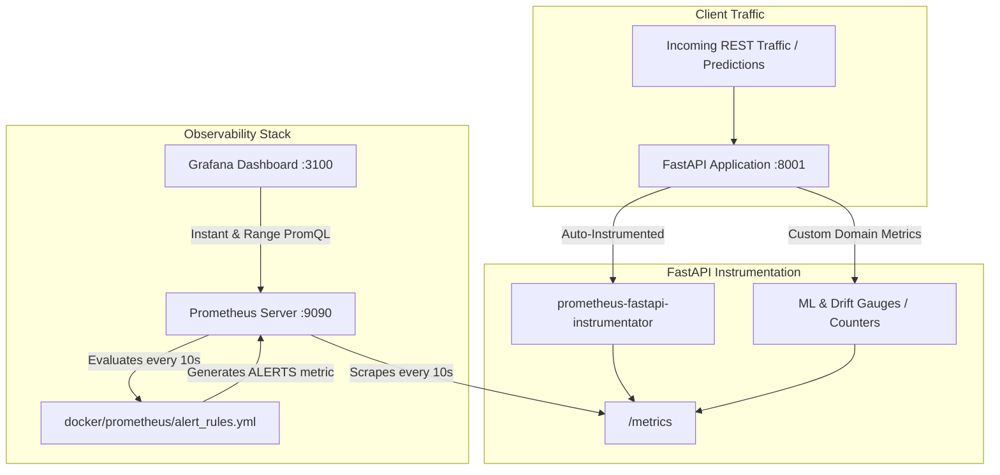

# 📈 FastAPI & MLOps Production Telemetry Guide

**Target Scope:** Real-Time Service, System, ML Inference, and Data Drift Observability  
**Stack:** FastAPI, `prometheus-fastapi-instrumentator`, Prometheus, Grafana, Evidently AI, ONNX Runtime  
**Dashboard UID:** `fastapi-mlops-overview`  
**Default Access:**
- **Grafana:** [http://localhost:3100](http://localhost:3100) (`admin` / `admin`)
- **Prometheus UI & Alerts:** [http://localhost:9090](http://localhost:9090)
- **FastAPI Metrics Endpoint:** [http://localhost:8100/metrics](http://localhost:8100/metrics)

---

## 🎯 Architecture Overview



---

## 📊 Telemetry Metric Catalog

Telemetry in this project is organized into **4 distinct layers**:

```
Layer 1: HTTP & API Traffic      → Measures user traffic, throughput, and error rates
Layer 2: System & Resource OS     → Measures RAM, CPU, and file descriptors
Layer 3: ML Inference & Serving  → Measures pure model latency, predictions, and engine health
Layer 4: Data Drift (Evidently)   → Measures statistical distribution shift between train & test data
```

---

### Layer 1: HTTP & API Traffic Telemetry

Supplied by `prometheus-fastapi-instrumentator` in `src/presentation/rest/serve_api.py`.

| Metric Name | Type | Key Labels | Reason We Have It |
| :--- | :--- | :--- | :--- |
| **`http_requests_total`** | `Counter` | `handler`, `method`, `status` | **Throughput & Error Tracking:** Counts every incoming HTTP request. Categorizes responses by status family (`2xx`, `4xx`, `5xx`). Used to calculate Requests Per Second (RPS) and error percentages. |
| **`http_request_duration_seconds`** | `Histogram` | `handler`, `method`, `status` | **End-to-End Latency:** Measures total request turnaround time from client receipt to response return. Used to plot P50, P95, and P99 service response percentiles. |
| **`http_requests_in_progress`** | `Gauge` | `handler`, `method` | **Concurrency & Saturation:** Tracks concurrent in-flight requests. High values indicate worker thread starvation or blocking I/O calls. |

---

### Layer 2: System & OS Resource Telemetry

Collected directly from the Linux `/proc` filesystem by the Python Prometheus client.

| Metric Name | Type | Key Labels | Reason We Have It |
| :--- | :--- | :--- | :--- |
| **`process_resident_memory_bytes`** | `Gauge` | `job`, `instance` | **RAM Consumption & OOM Prevention:** Measures physical RAM (RSS) actively used by the Python process. Essential in ML because loading heavy models, ONNX graphs, or DataFrames can trigger container Out-Of-Memory (OOM) kills. |
| **`process_cpu_seconds_total`** | `Counter` | `job`, `instance` | **CPU Saturation:** Total user and system CPU core time. Used to detect CPU starvation during matrix transformations or tensor calculations. |
| **`process_open_fds`** | `Gauge` | `job`, `instance` | **File Descriptor Leaks:** Tracks active sockets, database connections, and opened file handles to prevent OS-level `Too many open files` crashes. |

---

### Layer 3: Machine Learning Inference & Serving Telemetry

Custom domain metrics defined in `src/presentation/rest/routers/ml.py`.

| Metric Name | Type | Key Labels | Reason We Have It |
| :--- | :--- | :--- | :--- |
| **`ml_predictions_total`** | `Counter` | `model_name`, `prediction_class` | **Production Class Balance:** Tracks predictions broken down by class label (e.g. `Class 0`, `Class 1`, `Class 2`). If a 3-class classifier suddenly starts predicting 99% Class 0 in production, this reveals input corruption or model degradation. |
| **`ml_inference_duration_seconds`** | `Histogram` | `model_name` | **Pure Model Compute Latency:** Isolates mathematical inference execution time (ONNX runtime / Scikit-Learn) from HTTP networking, body serialization, and middleware overhead. Used to calculate P50, P95, and P99 pure inference curves. |
| **`ml_model_status`** | `Gauge` | `model_name`, `engine` | **Engine Readiness & Liveness:** Emits `1.0` when the active model is loaded and ready for inference, and `0.0` if unavailable or missing. Labels indicate runtime backend (`ONNX Runtime` vs `Scikit-Learn Fallback`). |

---

### Layer 4: MLOps Data Drift Telemetry (Evidently Integration)

Published on each invocation of `POST /ml/drift` in `src/presentation/rest/routers/ml.py`.

| Metric Name | Type | Key Labels | Reason We Have It |
| :--- | :--- | :--- | :--- |
| **`ml_data_drift_detected`** | `Gauge` | None | **Binary Alarm Flag:** Emits `1` if dataset-level statistical distribution shift is detected by Evidently, `0` if incoming data matches baseline reference data. |
| **`ml_data_drift_share`** | `Gauge` | None | **Drift Severity Ratio:** Float from `0.0` to `1.0` representing the exact proportion of input features that have drifted. Triggers warning alerts when $>30\%$ of features diverge. |

---

## 🚨 Prometheus Alert Rules Reference

Configured in `docker/prometheus/alert_rules.yml` and evaluated every 10 seconds:

| Rule Name | Severity | Condition (PromQL) | Threshold / Duration | Purpose |
| :--- | :---: | :--- | :--- | :--- |
| **`FastAPIServiceDown`** | `critical` | `up{job="fastapi_api"} == 0` | For 1 minute | Alerts immediately if the API container crashes or becomes uncontactable. |
| **`HighHttp5xxErrorRate`** | `critical` | `(sum(rate(http_requests_total{status=~"5.*"}[5m])) / sum(rate(http_requests_total[5m]))) * 100 > 5` | For 2 minutes | Catches internal server errors, unhandled exceptions, and 500 spikes. |
| **`HighInferenceLatency`** | `warning` | `histogram_quantile(0.95, sum(rate(ml_inference_duration_seconds_bucket[5m])) by (le, model_name)) > 0.1` | For 1 minute | Warns if P95 inference latency exceeds 100ms. |
| **`ModelUnavailable`** | `critical` | `ml_model_status == 0` | For 1 minute | Alerts when the model is offline or failed to initialize on startup. |
| **`ModelDataDriftDetected`** | `warning` | `ml_data_drift_detected == 1` | Immediate (`for: 0m`) | Signals that incoming data significantly deviates from training data. |
| **`HighFeatureDriftShare`** | `warning` | `ml_data_drift_share > 0.3` | Immediate (`for: 0m`) | Warns when more than 30% of input features exhibit statistical drift. |

---

## 🎛️ Dashboard Templating & Interactive Dropdown Filters

The Grafana dashboard includes 3 top-bar template variables for dynamic interactive filtering without editing PromQL queries:

| Variable | Dropdown Label | Type | Options / Source | Description |
| :--- | :--- | :---: | :--- | :--- |
| **`$model_name`** | **Model Name** | `query` | Dynamically queried from `ml_model_status` (Supports `All` + Multi-select) | Filters prediction counters, distribution donuts, model status, and inference latency curves for a specific model (e.g. `random_forest`). |
| **`$rate_interval`** | **Rate Interval** | `interval` | `30s`, `1m`, `2m`, `5m`, `10m`, `15m`, `30m` (Default: `1m`) | Controls the rate calculation window across throughput, error rates, CPU load, and latency histograms. |
| **`$handler`** | **Endpoint / Handler** | `query` | Dynamically queried from `http_requests_total` (Supports `All` + Multi-select) | Filters throughput and latency graphs for specific routes (e.g. `/ml/predict`, `/ml/drift`, `/metrics`). |

---

## 🖥️ Grafana Dashboard Layout

Auto-provisioned via `docker/grafana/provisioning/dashboards/fastapi_telemetry.json`:

1. **Application Health & Overview (Row 1):**
   - Total API Requests (Counter Stat)
   - Process Memory RAM (RSS Gauge)
   - 4xx / 5xx Error Rate % (Threshold Stat)
   - Open File Descriptors (Count Stat)

2. **Machine Learning & Model Serving Telemetry (Row 2):**
   - Total Predictions Served (Counter Stat)
   - Active Model Status & Engine (`1.0 - ONNX Runtime`)
   - Data Drift State (`Stable` 🟢 vs `DRIFT DETECTED` 🔴)
   - Drifting Features Share (`0% – 100%` with green/yellow/red thresholds)
   - Prediction Distribution by Class (Donut Chart)
   - Pure Model Inference Latency (P99, P95, P50 Time-Series Lines)

3. **HTTP Traffic & Performance Graphs (Row 3):**
   - Throughput by Endpoint (Requests / sec Time-Series)
   - Total HTTP Response Latency Percentiles (Time-Series)
   - Memory Consumption Over Time (Time-Series)
   - CPU Load Over Time (Time-Series)

4. **Alerting & Incident Management (Row 4):**
   - Active Firing Alerts Count (`0 Firing = All Systems Normal` 🟢 vs `>0` 🔴)
   - Active Alerts Status & Severity Details (Table with color badges)

---

## 🛠️ Testing & Simulation Cheatsheet

### 1. Test Model Inference Telemetry
```bash
curl -X POST http://localhost:8100/ml/predict \
  -H "Content-Type: application/json" \
  -d '{"features": {"sepal_length": 5.1, "sepal_width": 3.5, "petal_length": 1.4, "petal_width": 0.2}}'
```
*Updates: `http_requests_total`, `ml_predictions_total`, and `ml_inference_duration_seconds`.*

### 2. Test Data Drift Telemetry
```bash
curl -X POST http://localhost:8100/ml/drift \
  -H "Content-Type: application/json" \
  -d '{"reference_data_path": "data/processed/dataset_train.parquet", "current_data_path": "data/processed/dataset_test.parquet"}'
```
*Updates: `ml_data_drift_detected`, `ml_data_drift_share`, and triggers `HighFeatureDriftShare` if $>30\%$.*

### 3. Simulate API Outage Alert
```bash
# Stop the API container
docker stop sgproject-api-1

# Observe alert transition in http://localhost:9090/alerts
# 10s: PENDING -> 60s: FIRING

# Restore service
docker start sgproject-api-1
```
